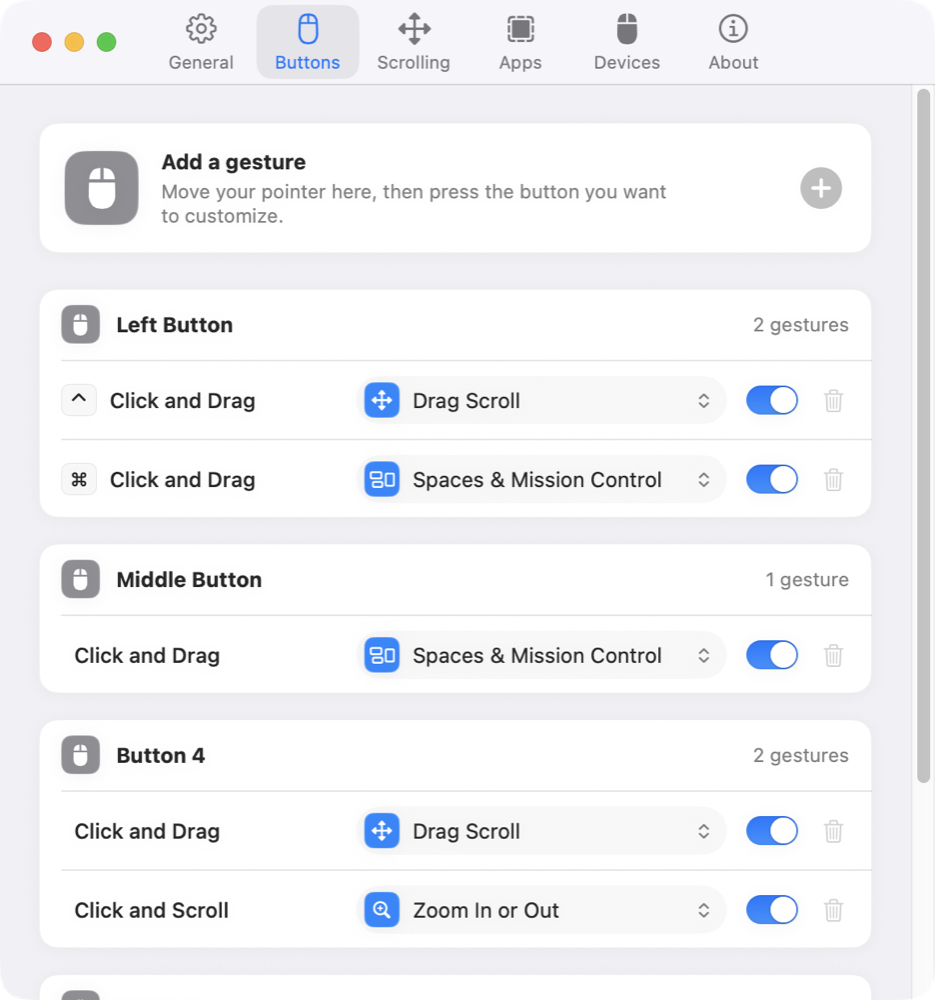
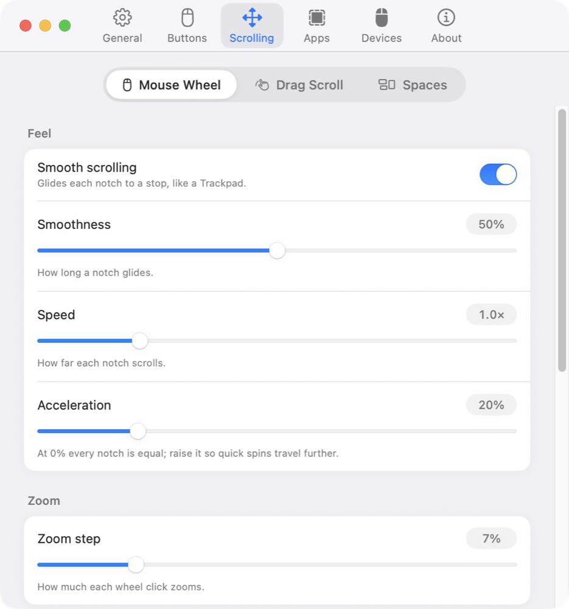
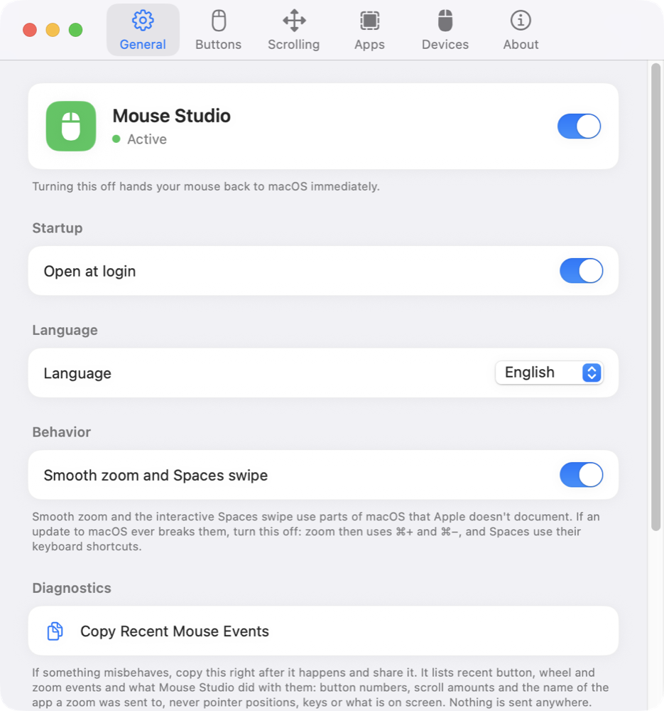
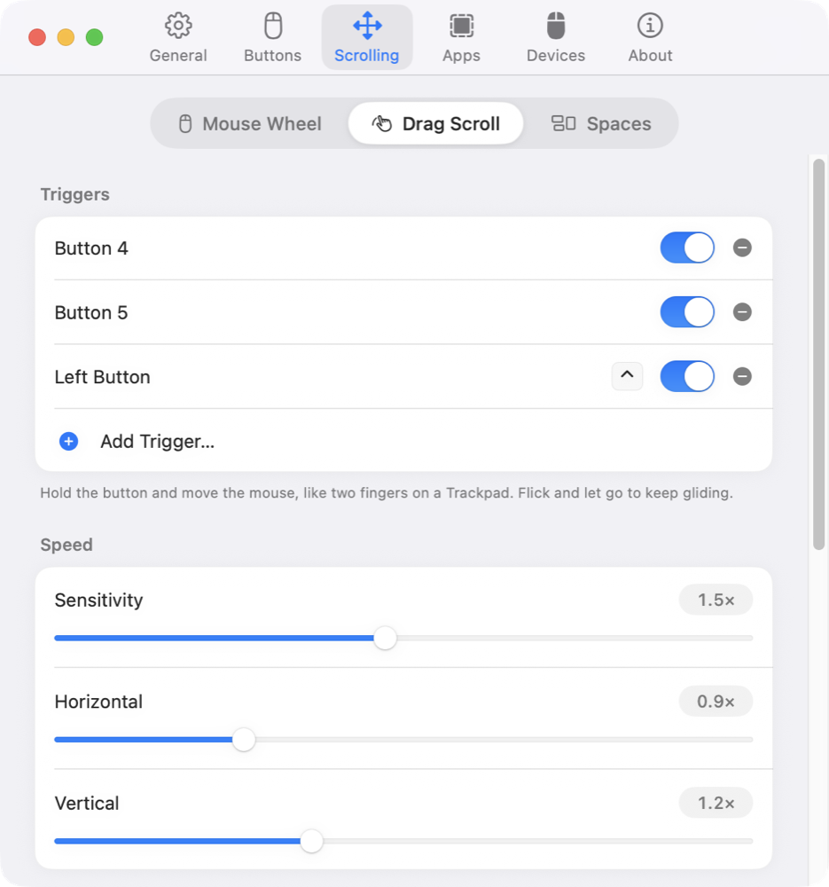
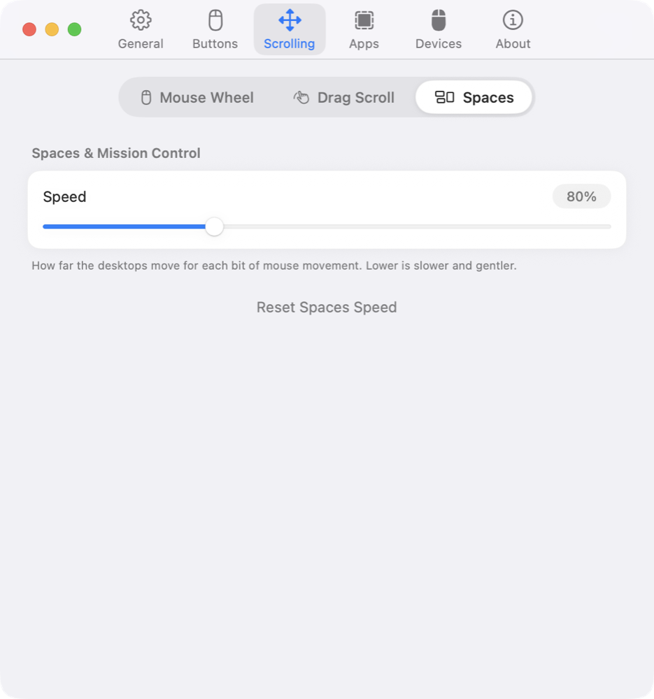
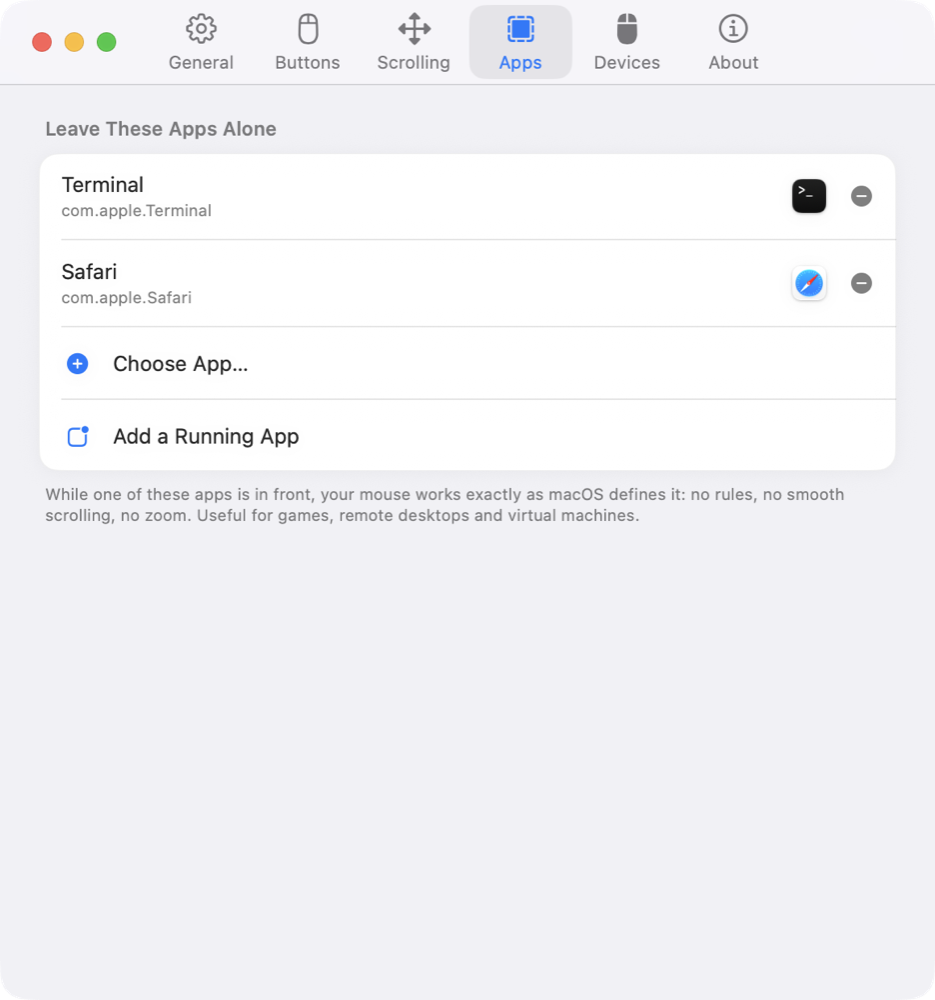
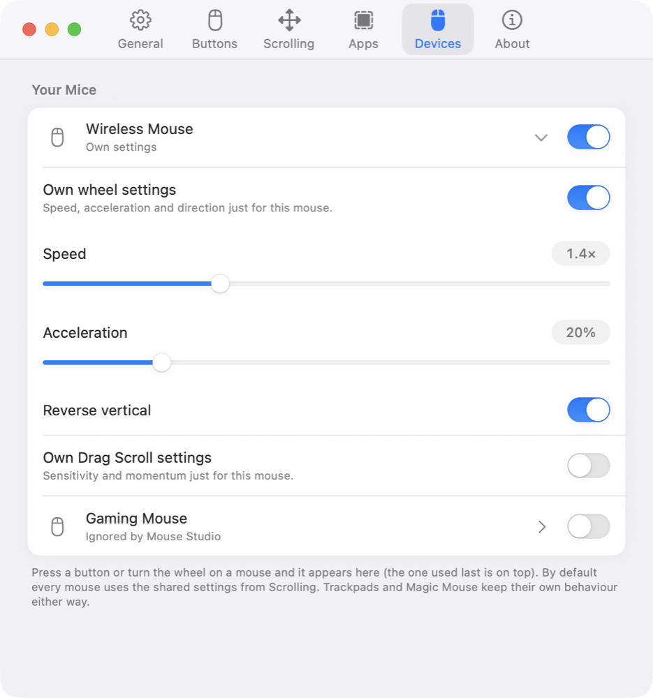
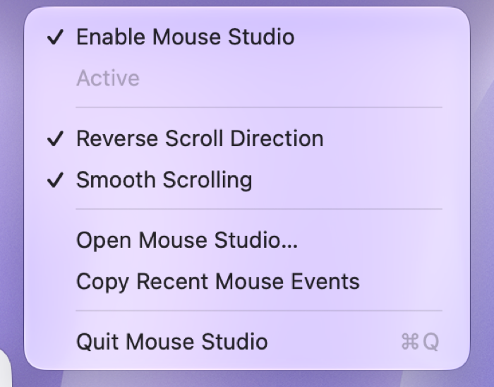

<h1 align="center">Mouse Studio</h1>

<p align="center">
  Make any mouse work the way you do on a Mac: assign actions to buttons, scroll in any direction by dragging,<br>
  smooth the wheel, zoom and swipe Spaces like on a Trackpad.<br>
  <b>English</b> · <a href="README.vi.md">Tiếng Việt</a>
</p>

<p align="center">
  
  &nbsp;
  
</p>

Mouse Studio is a small native macOS app (Swift + SwiftUI). It lives in the menu bar, works with any mouse brand,
keeps everything on your Mac and sends nothing anywhere.

## Contents
- [What you can do](#what-you-can-do)
- [Install](#install)
- [Quick start](#quick-start)
- [The settings, tab by tab](#the-settings-tab-by-tab)
- [The default setup](#the-default-setup)
- [Tips and troubleshooting](#tips-and-troubleshooting)
- [Privacy and safety](#privacy-and-safety)
- [Build from source](#build-from-source)

## What you can do

| Feature | In one sentence |
|---|---|
| **Button gestures** | Give any mouse button an action: click, double-click, hold, drag, or turn the wheel while holding it. |
| **Drag Scroll** | Hold a button and move the mouse to scroll in any direction, with Trackpad-style momentum. |
| **Spaces & Mission Control** | Hold a button and drag: desktops follow your hand, just like a three-finger swipe. |
| **Smooth wheel** | Reverse the direction, change the speed and acceleration, and glide each notch like a Trackpad. |
| **Zoom with the wheel** | Hold a button (or ⌘) and turn the wheel to pinch-zoom in Preview, Photos, Maps, browsers and more. |
| **Keys while scrolling** | ⇧ scrolls sideways, ⌘ zooms, ⌃ scrolls faster, ⌥ scrolls precisely (all changeable). |
| **Leave some apps alone** | Turn Mouse Studio off in games, remote desktops and virtual machines. |
| **Find Windows** | Hold Right Option, type part of a window's title, let go to jump there. Glass list with previews. |
| **Per-mouse settings** | Switch Mouse Studio off for one mouse, or give it its own speed and Drag Scroll settings. |
| **Menu bar** | Pause, reverse the scroll direction or skip the app in front with one click. |
| **English and Vietnamese** | Pick the language in General. |

## Install

1. Download `Mouse-Studio-<version>.zip` from the [Releases](https://github.com/vinh-dq/Mouse-Studio/releases) page and unzip it.
2. Drag **Mouse Studio.app** into your **Applications** folder.
3. Open it. The app is not notarized by Apple yet, so macOS may say it can't verify the developer:
   right-click the app → **Open** → **Open**, or run
   `xattr -dr com.apple.quarantine "/Applications/Mouse Studio.app"` once in Terminal.
4. When asked, allow **Accessibility** in **System Settings → Privacy & Security → Accessibility**.
   Without it macOS does not let any app read or replace mouse buttons, and Mouse Studio stays idle.

Requirements: macOS 14 or later, Apple silicon Mac.

## Quick start

1. Open **Mouse Studio** and check that **General** says **Active**.
2. Open the **Buttons** tab, move the pointer over **Add a gesture** and press the mouse button you want to customize.
   Mouse Studio recognises the button by itself, so you never need to know its number.
3. Pick **how** you press it (click, hold, drag…) and **what** it should do, then **Add Gesture**.
4. Try it. Changes apply immediately and are saved automatically.

## The settings, tab by tab

### General


- **On/off switch** – turning it off gives your mouse back to macOS immediately.
- **Open at login** – start Mouse Studio when you sign in.
- **Language** – English, Vietnamese or automatic (follows macOS). Restart the app to apply.
- **Smooth zoom and Spaces swipe** – these use parts of macOS that Apple doesn't document. If a macOS update ever breaks them,
  turn this off: zoom then uses ⌘+ / ⌘− and Spaces use their keyboard shortcuts.
- **Copy Recent Mouse Events** – copies a short log of recent button, wheel and zoom events to share when something misbehaves
  (button numbers, scroll amounts and the app a zoom went to; never pointer positions, typed keys or screen contents).
- **Export / Import / Reset configuration** – back up your setup, move it to another Mac, or go back to the defaults.
  Script gestures arrive switched off when you import.

<br clear="all">

### Buttons


Every gesture is one row: **how you press** the button → **what happens**.

**How you press** (the "When I" choices):
- **Click**, **Double Click**, **Hold**
- **Click and Drag** – hold the button and move the mouse
- **Click and Scroll** – hold the button and turn the wheel

Hold **⌘ ⌥ ⌃ ⇧** while you press to make combinations (for example *Left button + ⌃ + drag*).

**What happens** – pick from groups:
- **Mouse** – middle click, or do nothing
- **Navigate** – Back, Forward, move to the Space on the left or right
- **macOS** – Mission Control, App Exposé, Show Desktop, Launchpad, previous app, minimize or close the window
- **Media** – volume, mute, play/pause, next/previous track
- **Custom** – a keyboard shortcut, open an app, open a link, or run a shell command
- Continuous actions: **Drag Scroll**, **Spaces & Mission Control** (drag), **Zoom In or Out** and **Adjust Volume** (scroll)

Use the switch on a row to turn a gesture off without deleting it, and the bin to remove it.

> The left and right buttons always need a key held with them (⌘ ⌥ ⌃ ⇧), and double-click is never remapped on them,
> so you can't lock yourself out and opening files keeps working.

<br clear="all">

### Scrolling
Three pages, switched with the pill at the top.

**Mouse Wheel**


- **Smooth scrolling / Smoothness** – glide each notch to a stop, like a Trackpad.
- **Speed** – how far each notch scrolls.
- **Acceleration** – at 0% every notch is equal; raise it so quick spins travel further.
- **Zoom step** – how much each wheel click zooms while you hold a zoom button or key. Every click counts, so five quick clicks zoom five steps.
- **Direction** – reverse vertical and horizontal scrolling for the wheel (Trackpad and Magic Mouse are never touched).
- **Hold a Key While Scrolling** – click a box, hold the keys you want, let go. Four jobs: scroll sideways, zoom, scroll swiftly (×3), scroll precisely (×0.3).

<br clear="all">

**Drag Scroll**


Hold a trigger button and move the mouse to scroll in any direction. Flick and let go to keep gliding.
- **Triggers** – the buttons that start Drag Scroll. Add one with **Add Trigger…**, then press the button.
- **Speed** – overall sensitivity, plus separate horizontal and vertical speed.
- **Feel** – smoothness and momentum (how far it keeps gliding after you let go).
- **Behavior** – content follows the mouse or the opposite way, lock to one axis, freeze the pointer while scrolling.

<br clear="all">

**Spaces**


How far the desktops move for each bit of mouse movement. Lower is slower and gentler. Use it with a
**Spaces & Mission Control** gesture: drag left or right to move between Spaces, up for Mission Control, down for App Exposé.

<br clear="all">

### Windows
Hold **Right Option** (or Left Option, Right Command, Right Control: your choice) for a quarter of a second and a glass list of every open window appears.
Type part of an app name or a title (accents don't matter: `cua so` finds “Cửa sổ”), then let go of the key to switch.
A quick tap, or any other key pressed sooner, still belongs to your app.

| Key | What it does |
|---|---|
| letters | Filter by app name and window title |
| ⇥ ← → ↑ ↓ | Choose a window (or move the pointer over one) |
| Space | Quick look at the chosen window (when nothing is typed) |
| ⌘W · ⌘M | Close · minimize the chosen window |
| ⌘Q · ⌘H | Quit · hide its app |
| ↩ · esc | Switch right away · cancel |

Letting go of the key switches only if you typed, chose or looked at a window; otherwise the list just closes.
Pictures of the windows need **Screen Recording** access; without it the list shows app icons. Mouse Studio only reads
titles and takes the pictures while the list is open. Windows on other desktops are listed when Screen Recording is allowed.
You can also open the list with any mouse button: add a gesture and choose **Find Window**.

### Apps


Apps in this list get your mouse exactly as macOS delivers it while they are in front: no gestures, no smooth scrolling, no zoom.
Good for games, remote desktops and virtual machines.
Add an app with **Choose App…** or **Add a Running App**, or from the menu bar with **Leave <app> Alone**.

<br clear="all">

### Devices


Every mouse you use shows up here (press a button or turn the wheel on it; the one used last is on top).
- The **switch** turns Mouse Studio off for that mouse completely.
- Open the **arrow** to give the mouse **its own wheel settings** (speed, acceleration, direction) and/or **its own Drag Scroll settings**.
- Mice without their own settings use the shared ones from Scrolling.
- Trackpads and Magic Mouse are never listed and never changed.

<br clear="all">

### Menu bar


Click the mouse icon in the menu bar for quick switches: enable or pause Mouse Studio, reverse the scroll direction, turn smooth
scrolling on or off, leave the app in front alone, open the settings, copy the recent events, quit.

<br clear="all">

## The default setup

A fresh install starts with this setup (you can change everything):

| You do | Mouse Studio does |
|---|---|
| Hold **Button 4** or **Button 5** and move the mouse | **Drag Scroll** |
| Hold **Button 4** or **Button 5** and turn the wheel | **Zoom** in or out |
| Hold the **middle button** and drag | **Spaces & Mission Control** swipe |
| Hold **left button + ⌃** and drag | **Drag Scroll** |
| Hold **left button + ⌘** and drag | **Spaces & Mission Control** swipe |
| Turn the wheel | Smooth, reversed vertical scrolling |
| Hold **⇧ / ⌘ / ⌃ / ⌥** and turn the wheel | Scroll sideways / zoom / scroll faster / scroll precisely |

## Tips and troubleshooting

- **Nothing happens.** Check **General** says *Active* and that Mouse Studio is allowed in *Privacy & Security → Accessibility*.
  If you rebuilt or replaced the app, remove it from that list and add it again.
- **A button does the wrong thing.** Open **Buttons** and look at that button's rows; a plain click on a button that only has a drag gesture still works as a normal click.
- **Zoom is odd in one app.** Open **General → Copy Recent Mouse Events** right after it happens and read the `zoom target` line: it
  tells you which app got the zoom and how. Browsers' pinch-zoom has a floor of 100% (it is a zoom of the picture of the page,
  not the page size): use a gesture with **Zoom In** / **Zoom Out** (⌘+ / ⌘−) for page zoom.
- **A game or remote desktop misbehaves.** Add it in **Apps**.
- **Something broke after a macOS update.** Turn off **General → Smooth zoom and Spaces swipe**.
- **Sharing a problem.** Paste the output of **Copy Recent Mouse Events**; it contains no keystrokes or pointer positions.

## Privacy and safety

- No network code. Settings are stored in `~/Library/Application Support/Mouse Studio` (readable only by you).
- A press that Mouse Studio swallows always has its release swallowed too, so buttons can't get stuck.
- Left and right buttons need a modifier key; double-click is never remapped on them.
- Modifier keys must match exactly; with no matching gesture the mouse is not touched.
- If macOS switches the event tap off, or after the Mac wakes up, state is reset and rebuilt.
- Script gestures are never switched on by an import, and switching one on asks for confirmation. A script is stopped after 30 seconds.
- Letting go of Drag Scroll after a flick keeps the content gliding; touching the mouse again stops it.

More detail: [docs/ARCHITECTURE.md](docs/ARCHITECTURE.md) and [docs/TECH_REVIEW.md](docs/TECH_REVIEW.md).

## Build from source

Needs only the Xcode Command Line Tools (full Xcode is not required).

```sh
./scripts/build_app.sh          # builds build/Mouse Studio.app
open "build/Mouse Studio.app"
swift test -Xswiftc -plugin-path -Xswiftc /Library/Developer/CommandLineTools/usr/lib/swift/host/plugins/testing   # unit tests
```

- With only the Command Line Tools, `swift test` needs the `-plugin-path` flag shown above, otherwise it may report "TestingMacros plugin not found".
- Always launch the built `.app`, not the bare executable, so the Accessibility permission attaches to the app.
- `UI/LocalState.swift` replaces `@State` because the SDK's `@State` macro plugin ships only with full Xcode.
- Translations live in `Resources/vi.lproj/Localizable.strings`, generated by `scripts/vi_strings.py`; a test keeps every `%@` / `%lld` placeholder intact.
- Smooth pinch zoom and the Spaces swipe use undocumented macOS behaviour (see the notes in `docs/ARCHITECTURE.md`); they may need updates after macOS releases.
