<h1 align="center">Mouse Studio</h1>

<p align="center">
  Giúp mọi con chuột hoạt động theo ý bạn trên Mac: gán hành động cho từng nút, kéo để cuộn theo mọi hướng,<br>
  cuộn con lăn mượt, zoom và vuốt chuyển Spaces như trên Trackpad.<br>
  <a href="README.md">English</a> · <b>Tiếng Việt</b>
</p>

<p align="center">
  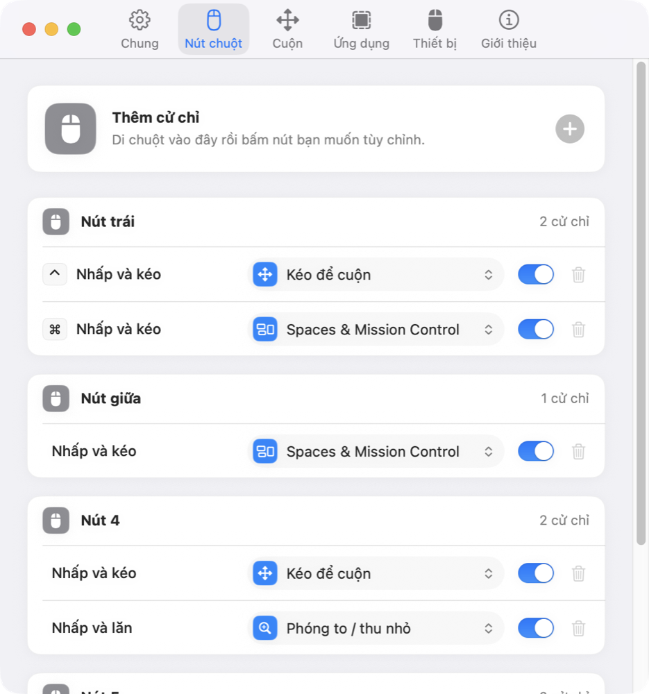
  &nbsp;
  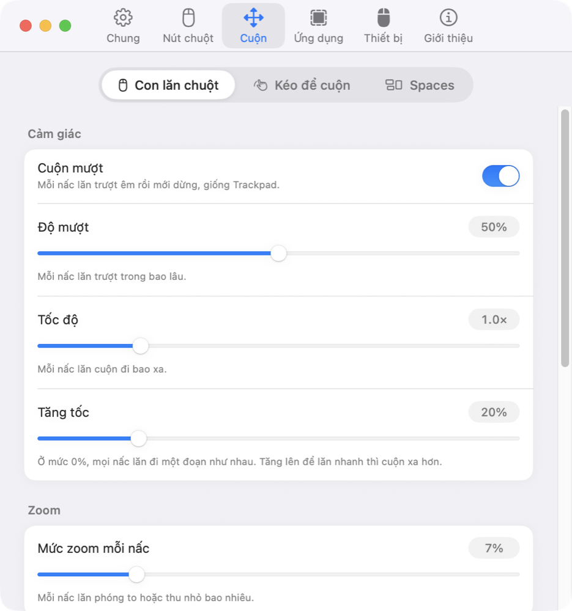
</p>

Mouse Studio là ứng dụng macOS nhỏ gọn (Swift + SwiftUI), nằm ở thanh menu, dùng được với mọi hãng chuột.
Mọi dữ liệu chỉ nằm trên máy Mac của bạn, không gửi đi đâu cả.

## Mục lục
- [Bạn làm được gì](#bạn-làm-được-gì)
- [Cài đặt](#cài-đặt)
- [Bắt đầu nhanh](#bắt-đầu-nhanh)
- [Các cài đặt, từng tab một](#các-cài-đặt-từng-tab-một)
- [Thiết lập mặc định](#thiết-lập-mặc-định)
- [Mẹo và xử lý sự cố](#mẹo-và-xử-lý-sự-cố)
- [Riêng tư và an toàn](#riêng-tư-và-an-toàn)
- [Tự build từ mã nguồn](#tự-build-từ-mã-nguồn)

## Bạn làm được gì

| Tính năng | Tóm tắt |
|---|---|
| **Cử chỉ cho nút chuột** | Gán hành động cho bất kỳ nút nào: nhấp, nhấp đúp, nhấn giữ, kéo, hoặc lăn con lăn khi đang giữ nút. |
| **Kéo để cuộn** | Giữ một nút rồi di chuyển chuột để cuộn theo mọi hướng, có đà trượt như Trackpad. |
| **Spaces & Mission Control** | Giữ một nút rồi kéo: màn hình ảo chạy theo tay bạn, giống vuốt ba ngón. |
| **Con lăn mượt** | Đảo chiều cuộn, chỉnh tốc độ và độ tăng tốc, mỗi nấc lăn trượt êm như Trackpad. |
| **Zoom bằng con lăn** | Giữ một nút (hoặc ⌘) rồi lăn để phóng to / thu nhỏ trong Preview, Ảnh, Bản đồ, trình duyệt… |
| **Phím khi lăn** | ⇧ cuộn ngang, ⌘ zoom, ⌃ cuộn nhanh, ⌥ cuộn chậm chính xác (đổi được). |
| **Bỏ qua một số ứng dụng** | Tắt Mouse Studio trong game, máy tính từ xa và máy ảo. |
| **Tìm cửa sổ** | Giữ Option bên phải, gõ một phần tiêu đề cửa sổ, thả phím để chuyển tới đó. Danh sách kính có ảnh xem trước. |
| **Tìm tab** | Nhấn phím tắt lần nữa (hoặc nhấn ⇥) để tìm trong các tab của Safari, Chrome và trình duyệt Chromium khác, rồi nhảy đúng tới tab đó. |
| **Cài đặt riêng cho từng chuột** | Tắt Mouse Studio cho một chuột, hoặc cho nó tốc độ và Kéo để cuộn riêng. |
| **Thanh menu** | Tạm dừng, đảo chiều cuộn hoặc bỏ qua ứng dụng đang mở chỉ với một cú nhấp. |
| **Tiếng Anh và tiếng Việt** | Chọn ngôn ngữ trong tab Chung. |

## Cài đặt

1. Tải `Mouse-Studio-<phiên bản>.zip` ở trang [Releases](https://github.com/vinh-dq/Mouse-Studio/releases) rồi giải nén.
2. Kéo **Mouse Studio.app** vào thư mục **Applications** (Ứng dụng).
3. Mở ứng dụng. Ứng dụng chưa được Apple notarize nên macOS có thể báo không xác minh được nhà phát triển:
   nhấp chuột phải vào ứng dụng → **Mở** → **Mở**, hoặc chạy một lần lệnh sau trong Terminal:
   `xattr -dr com.apple.quarantine "/Applications/Mouse Studio.app"`
4. Khi được hỏi, hãy cho phép **Trợ năng (Accessibility)** trong **Cài đặt hệ thống → Quyền riêng tư & Bảo mật → Trợ năng**.
   Không có quyền này, macOS không cho ứng dụng nào đọc hay thay đổi nút chuột, và Mouse Studio sẽ đứng yên.

Yêu cầu: macOS 14 trở lên, máy Mac chip Apple silicon.

## Bắt đầu nhanh

1. Mở **Mouse Studio**, kiểm tra tab **Chung** hiện **Đang hoạt động**.
2. Mở tab **Nút chuột**, đưa con trỏ vào ô **Thêm cử chỉ** rồi bấm nút chuột bạn muốn tùy chỉnh.
   Mouse Studio tự nhận ra nút đó, bạn không cần biết nút số mấy.
3. Chọn bạn bấm **thế nào** (nhấp, nhấn giữ, kéo…) và nó sẽ **làm gì**, rồi bấm **Thêm cử chỉ**.
4. Dùng thử. Thay đổi có tác dụng ngay và được tự động lưu.

## Các cài đặt, từng tab một

### Chung
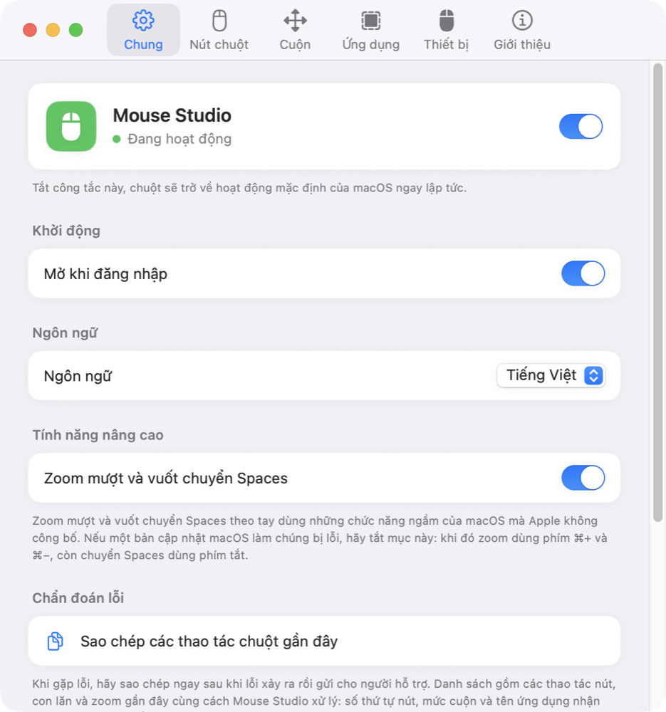

- **Công tắc bật/tắt** – tắt đi là chuột trở về hoạt động mặc định của macOS ngay lập tức.
- **Mở khi đăng nhập** – tự mở Mouse Studio khi bạn đăng nhập máy.
- **Ngôn ngữ** – English, Tiếng Việt hoặc tự động (theo macOS). Khởi động lại ứng dụng để áp dụng.
- **Zoom mượt và vuốt chuyển Spaces** – hai tính năng này dùng chức năng ngầm của macOS mà Apple không công bố. Nếu một bản cập nhật macOS
  làm chúng lỗi, hãy tắt mục này: zoom sẽ dùng ⌘+ / ⌘− và chuyển Spaces dùng phím tắt.
- **Sao chép các thao tác chuột gần đây** – chép một bản ghi ngắn về các thao tác nút, con lăn và zoom gần đây để gửi khi gặp lỗi
  (chỉ gồm số nút, mức cuộn và ứng dụng nhận zoom; không có vị trí con trỏ, phím đã gõ hay nội dung màn hình).
- **Xuất / Nhập / Đặt lại cấu hình** – sao lưu thiết lập, chuyển sang máy Mac khác hoặc quay về mặc định.
  Các cử chỉ chạy script khi nhập vào sẽ ở trạng thái tắt.

<br clear="all">

### Nút chuột


Mỗi cử chỉ là một dòng: **cách bấm** nút → **điều xảy ra**.

**Cách bấm** (phần "Khi tôi"):
- **Nhấp**, **Nhấp đúp**, **Nhấn giữ**
- **Nhấp và kéo** – giữ nút và di chuyển chuột
- **Nhấp và lăn** – giữ nút và lăn con lăn

Giữ thêm **⌘ ⌥ ⌃ ⇧** khi bấm để tạo tổ hợp (ví dụ *nút trái + ⌃ + kéo*).

**Điều xảy ra** – chọn trong các nhóm:
- **Chuột** – nhấp nút giữa, hoặc không làm gì
- **Điều hướng** – Quay lại, Tiến tới, chuyển sang Space bên trái hoặc phải
- **macOS** – Mission Control, App Exposé, Hiện màn hình nền, Launchpad, ứng dụng trước đó, thu nhỏ hoặc đóng cửa sổ
- **Đa phương tiện** – âm lượng, tắt tiếng, phát / tạm dừng, bài tiếp theo / bài trước
- **Tùy chỉnh** – phím tắt, mở ứng dụng, mở liên kết hoặc chạy lệnh shell
- Hành động liên tục: **Kéo để cuộn**, **Spaces & Mission Control** (kéo), **Phóng to / thu nhỏ** và **Chỉnh âm lượng** (lăn)

Dùng công tắc ở mỗi dòng để tắt cử chỉ mà không xóa, và biểu tượng thùng rác để xóa.

> Nút trái và nút phải luôn cần giữ kèm một phím (⌘ ⌥ ⌃ ⇧), và không bao giờ đổi được nhấp đúp,
> để bạn không tự khóa mình khỏi máy và việc mở tệp luôn hoạt động.

<br clear="all">

### Cuộn
Có ba trang, chuyển bằng thanh viên thuốc ở trên cùng.

**Con lăn chuột**


- **Cuộn mượt / Độ mượt** – mỗi nấc lăn trượt êm rồi mới dừng, giống Trackpad.
- **Tốc độ** – mỗi nấc lăn cuộn đi bao xa.
- **Tăng tốc** – ở mức 0%, mọi nấc lăn đi một đoạn như nhau; tăng lên để lăn nhanh thì cuộn xa hơn.
- **Mức zoom mỗi nấc** – mỗi nấc lăn phóng to hoặc thu nhỏ bao nhiêu khi bạn giữ nút hoặc phím zoom. Mỗi nấc đều được tính, nên lăn nhanh năm nấc sẽ zoom năm bước.
- **Chiều cuộn** – đảo chiều cuộn dọc và ngang cho con lăn (Trackpad và Magic Mouse không bao giờ bị thay đổi).
- **Giữ phím khi lăn** – bấm vào một ô, giữ các phím bạn muốn rồi thả ra. Bốn việc: cuộn ngang, zoom, cuộn nhanh (×3), cuộn chậm chính xác (×0,3).

<br clear="all">

**Kéo để cuộn**
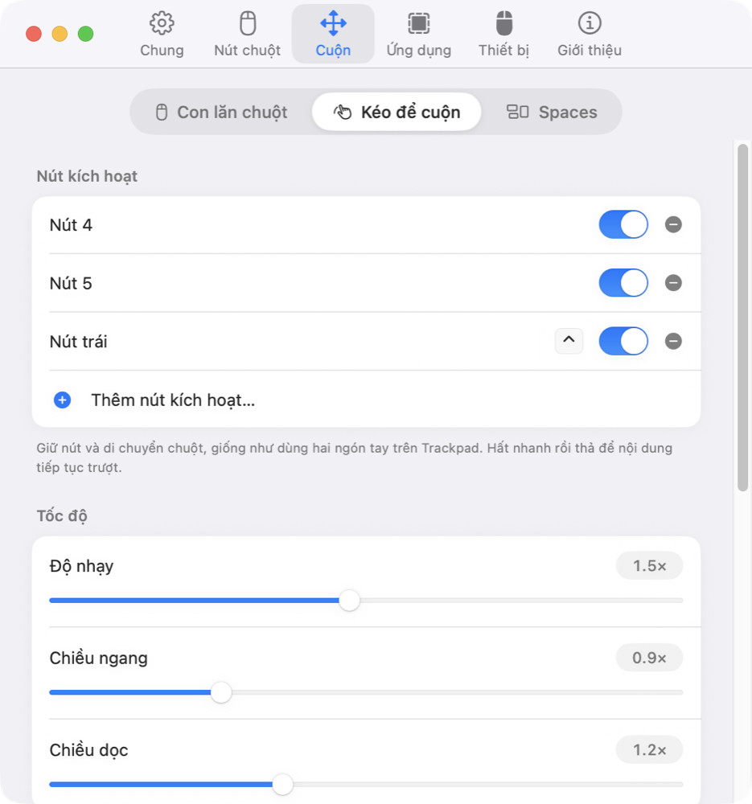

Giữ nút kích hoạt và di chuyển chuột để cuộn theo mọi hướng. Hất nhanh rồi thả để nội dung tiếp tục trượt.
- **Nút kích hoạt** – các nút bắt đầu Kéo để cuộn. Thêm bằng **Thêm nút kích hoạt…** rồi bấm nút bạn muốn.
- **Tốc độ** – độ nhạy chung, cùng tốc độ riêng cho chiều ngang và chiều dọc.
- **Cảm giác** – độ mượt và đà trượt (nội dung còn trượt thêm bao xa sau khi bạn thả tay).
- **Tính chất** – nội dung đi theo chuột hoặc ngược lại, khóa một hướng cuộn, giữ yên con trỏ khi đang cuộn.

<br clear="all">

**Spaces**
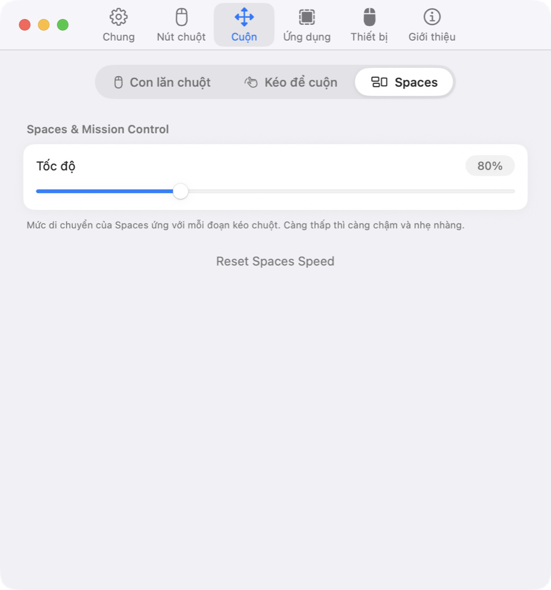

Mức di chuyển của Spaces ứng với mỗi đoạn kéo chuột. Càng thấp càng chậm và nhẹ nhàng. Dùng cùng cử chỉ
**Spaces & Mission Control**: kéo sang trái hoặc phải để chuyển Spaces, kéo lên để mở Mission Control, kéo xuống để mở App Exposé.

<br clear="all">

### Cửa sổ
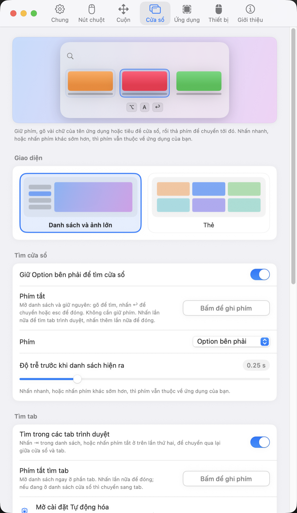

Giữ **Option bên phải** (hoặc Option trái, Command phải, Control phải) khoảng một phần tư giây, danh sách kính các cửa sổ đang mở sẽ hiện ra.
Hoặc ghi một **phím tắt** để mở danh sách và giữ nguyên: gõ để tìm, nhấn ↩ để chuyển, esc để đóng.
Gõ một phần tên ứng dụng hoặc tiêu đề (không cần dấu: `cua so` tìm ra “Cửa sổ”), rồi thả phím để chuyển.
Nhấn nhanh, hoặc nhấn phím khác sớm hơn, thì phím vẫn thuộc về ứng dụng của bạn.

| Phím | Tác dụng |
|---|---|
| chữ cái | Lọc theo tên ứng dụng và tiêu đề cửa sổ |
| ← → ↑ ↓ | Chọn cửa sổ (hoặc rê chuột lên cửa sổ đó) |
| ⇥ | Chuyển giữa cửa sổ và tab trình duyệt |
| ⌘W (ở danh sách tab) | Đóng tab đang chọn |
| Space | Xem nhanh cửa sổ đang chọn (khi chưa gõ gì) |
| ⌘W · ⌘M | Đóng · thu nhỏ cửa sổ đang chọn |
| ⌘Q · ⌘H | Thoát · ẩn ứng dụng của cửa sổ đó |
| ↩ · esc | Chuyển ngay · hủy |

Thả phím chỉ chuyển cửa sổ khi bạn đã gõ, đã chọn hoặc đang xem nhanh; nếu không, danh sách chỉ đóng lại.
Ảnh xem trước cần quyền **Ghi màn hình**; không có quyền này, danh sách hiện biểu tượng ứng dụng. Mouse Studio chỉ đọc tiêu đề
và chụp ảnh khi danh sách đang mở. Cửa sổ ở màn hình nền khác chỉ hiện khi đã cho phép Ghi màn hình.
Bạn cũng có thể mở danh sách bằng một nút chuột bất kỳ: thêm cử chỉ và chọn **Tìm cửa sổ**.

#### Tìm tab

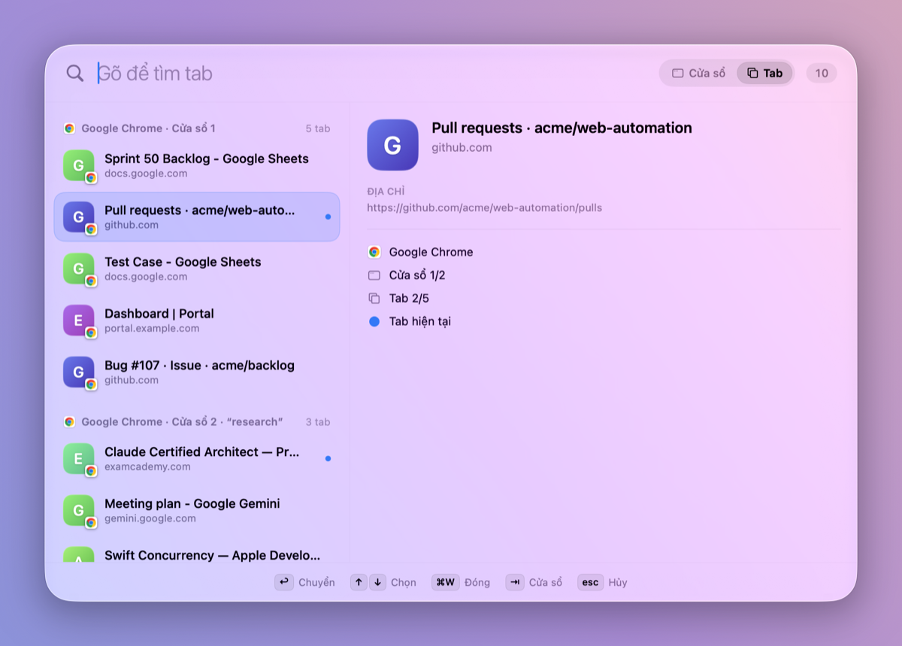

Cũng danh sách đó có thể tìm trong **các tab của trình duyệt**: Safari và các trình duyệt Chromium (Chrome, Edge, Brave, Vivaldi, Opera, Arc).
Bạn chọn cách nào tiện nhất; các cách không xung đột với nhau:

| Thao tác | Kết quả |
|---|---|
| Nhấn **phím tắt tìm cửa sổ** lần thứ hai | Danh sách chuyển từ cửa sổ sang tab (chữ đã gõ được giữ lại). Nhấn lần thứ ba để đóng. |
| Nhấn **⇥** (Tab) | Chuyển qua lại giữa cửa sổ và tab. Chọn bằng phím mũi tên. |
| Bấm **Cửa sổ** hoặc **Tab** trên dòng tìm kiếm | Chuyển như trên, bằng chuột. |
| Nhấn **phím tắt tìm tab** (ghi trong Cửa sổ → Tìm tab) | Mở danh sách ngay ở phần tab. Nhấn lần nữa để đóng; nếu đang ở danh sách cửa sổ thì chuyển sang tab. |

Giữ phím chỉ mở danh sách cửa sổ. Hai phím tắt phải khác nhau.
Tab được xếp theo từng cửa sổ trình duyệt (cửa sổ bạn đang dùng ở đầu), tab hiện tại của mỗi cửa sổ có chấm xanh, và danh sách mở sẵn ở tab bạn đang đứng.
Khi gõ, kết quả khớp nhất lên đầu trên mọi cửa sổ; việc tìm xét cả tiêu đề **lẫn** địa chỉ (`docs sheets`, `github pulls`).
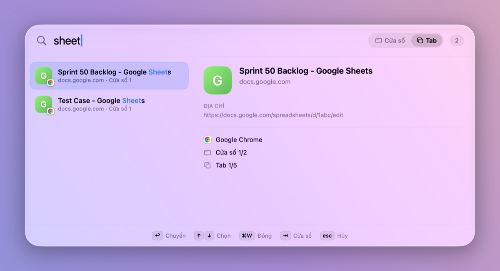

Nhấn ↩ là Mouse Studio chọn đúng tab đó, đưa cửa sổ của nó lên và chuyển tới màn hình nền chứa cửa sổ. Tab trong cửa sổ riêng tư vẫn hiện, nhưng lựa chọn của bạn ở đó không bao giờ được ghi nhớ.

macOS sẽ hỏi một lần cho mỗi trình duyệt xem Mouse Studio có được điều khiển nó không (**Tự động hóa**). Mouse Studio chỉ đọc tiêu đề và địa chỉ khi danh sách đang mở; không có gì được lưu hay gửi đi.
Nếu bạn đã từ chối, danh sách sẽ báo và liên kết **Mở Cài đặt** đưa bạn tới Quyền riêng tư & Bảo mật → Tự động hóa. Firefox chưa tìm được vì không có cách chính thức để đọc tab của nó.

<br clear="all">

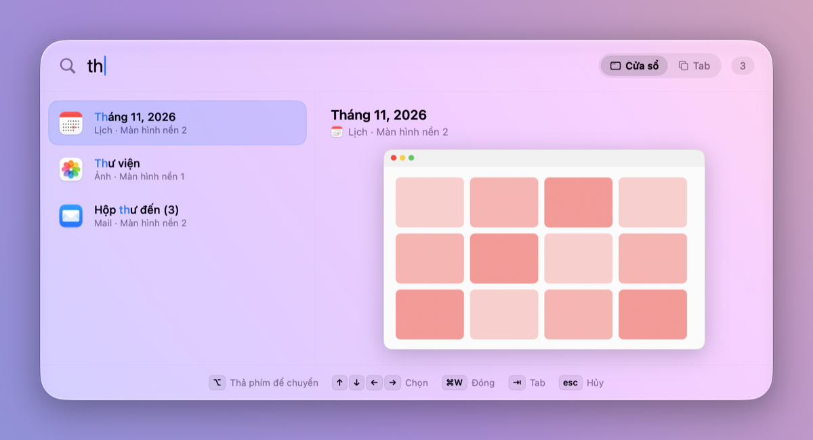

Mỗi cửa sổ cho biết nó nằm ở màn hình nền (và màn hình) nào. Chữ bạn gõ được tô nổi, và cửa sổ bạn hay chọn cho một cụm chữ sẽ lên đầu ở lần sau (tắt bằng **Nhớ lựa chọn của tôi**).
Trong tab, mục **Giao diện** cho chọn danh sách kèm ảnh lớn của cửa sổ đang chọn, hoặc dạng thẻ.

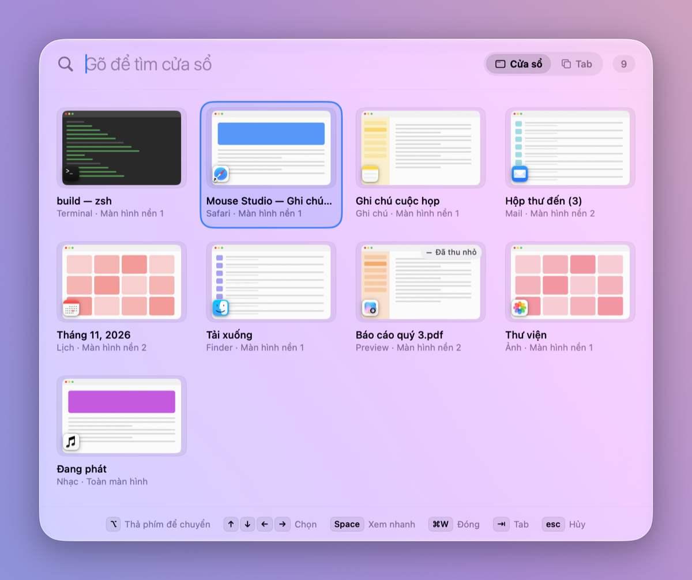

### Ứng dụng
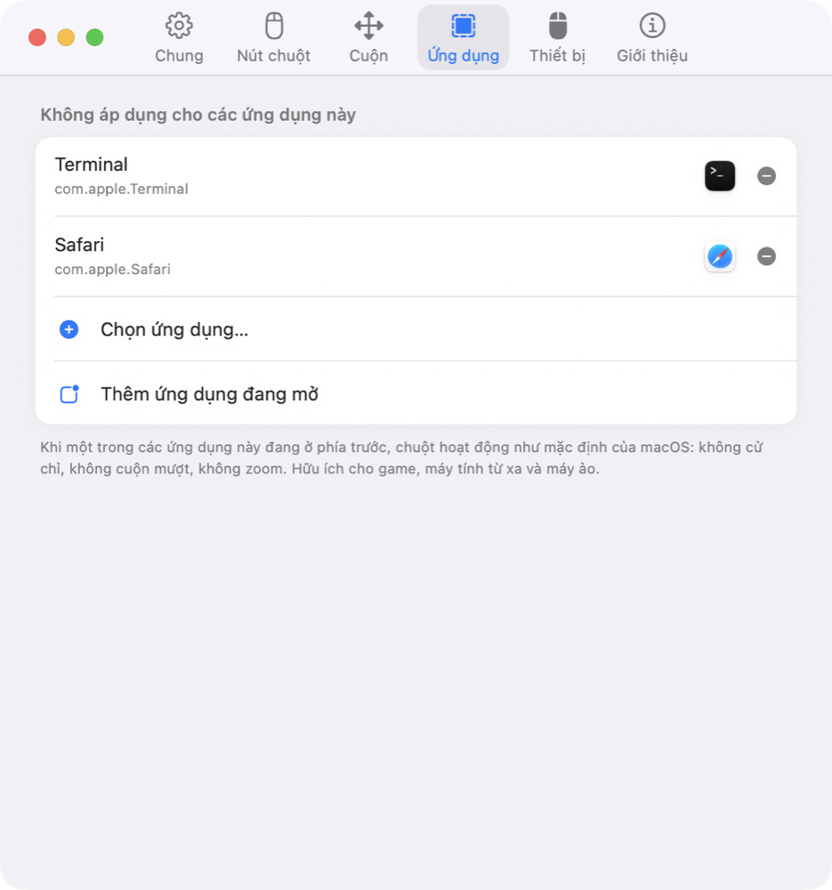

Khi một ứng dụng trong danh sách này đang ở phía trước, chuột hoạt động đúng như macOS mặc định: không cử chỉ, không cuộn mượt, không zoom.
Hữu ích cho game, máy tính từ xa và máy ảo.
Thêm ứng dụng bằng **Chọn ứng dụng…** hoặc **Thêm ứng dụng đang mở**, hoặc từ thanh menu bằng **Không áp dụng cho <ứng dụng>**.

<br clear="all">

### Thiết bị
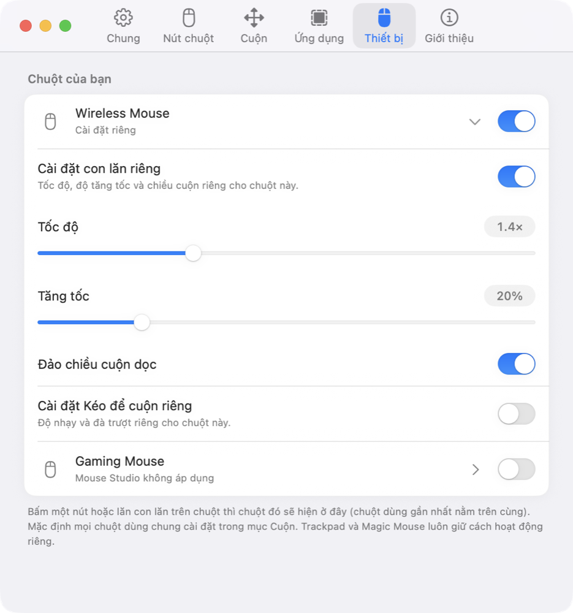

Mỗi con chuột bạn dùng sẽ hiện ở đây (bấm một nút hoặc lăn con lăn trên chuột đó; chuột dùng gần nhất nằm trên cùng).
- **Công tắc** tắt hẳn Mouse Studio cho chuột đó.
- Mở **mũi tên** để cho chuột **cài đặt con lăn riêng** (tốc độ, tăng tốc, chiều cuộn) và/hoặc **cài đặt Kéo để cuộn riêng**.
- Chuột không có cài đặt riêng sẽ dùng cài đặt chung trong tab Cuộn.
- Trackpad và Magic Mouse không bao giờ hiện ở đây và không bao giờ bị thay đổi.

<br clear="all">

### Thanh menu
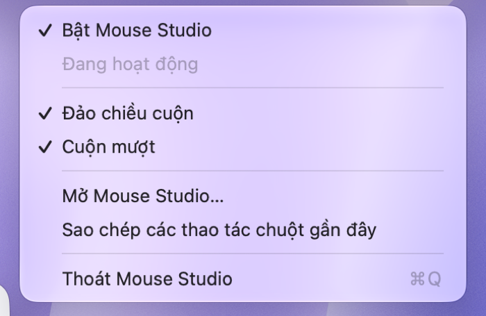

Nhấp biểu tượng chuột ở thanh menu để dùng các công tắc nhanh: bật hoặc tạm dừng Mouse Studio, đảo chiều cuộn, bật/tắt cuộn mượt,
bỏ qua ứng dụng đang mở, mở cài đặt, sao chép các thao tác gần đây, thoát.

<br clear="all">

## Thiết lập mặc định

Bản cài mới bắt đầu với thiết lập sau (bạn đổi được tất cả):

| Bạn làm | Mouse Studio làm |
|---|---|
| Giữ **Nút 4** hoặc **Nút 5** và di chuyển chuột | **Kéo để cuộn** |
| Giữ **Nút 4** hoặc **Nút 5** và lăn con lăn | **Zoom** phóng to / thu nhỏ |
| Giữ **nút giữa** và kéo | Vuốt **Spaces & Mission Control** |
| Giữ **nút trái + ⌃** và kéo | **Kéo để cuộn** |
| Giữ **nút trái + ⌘** và kéo | Vuốt **Spaces & Mission Control** |
| Lăn con lăn | Cuộn mượt, đảo chiều cuộn dọc |
| Giữ **⇧ / ⌘ / ⌃ / ⌥** và lăn | Cuộn ngang / zoom / cuộn nhanh / cuộn chậm chính xác |

## Mẹo và xử lý sự cố

- **Không có gì xảy ra.** Kiểm tra tab **Chung** hiện *Đang hoạt động* và Mouse Studio đã được bật trong *Quyền riêng tư & Bảo mật → Trợ năng*.
  Nếu bạn vừa build lại hay thay ứng dụng, hãy xóa nó khỏi danh sách đó rồi thêm lại.
- **Một nút làm sai việc.** Mở **Nút chuột** xem các dòng của nút đó; nhấp thường trên nút chỉ có cử chỉ kéo vẫn hoạt động như nhấp bình thường.
- **Zoom lạ ở một ứng dụng.** Mở **Chung → Sao chép các thao tác chuột gần đây** ngay sau khi lỗi xảy ra và đọc dòng `zoom target`: dòng đó cho biết
  ứng dụng nào nhận zoom và theo cách nào. Zoom kiểu pinch trong trình duyệt có mức thấp nhất là 100% (đó là phóng to hình ảnh của trang, không phải
  đổi cỡ trang): hãy dùng cử chỉ **Phóng to** / **Thu nhỏ** (⌘+ / ⌘−) để zoom cả trang.
- **Game hoặc máy tính từ xa chạy lạ.** Thêm nó vào tab **Ứng dụng**.
- **Có lỗi sau khi cập nhật macOS.** Tắt **Chung → Zoom mượt và vuốt chuyển Spaces**.
- **Gửi lỗi cho người hỗ trợ.** Dán nội dung của **Sao chép các thao tác chuột gần đây**; nội dung này không có phím đã gõ hay vị trí con trỏ.

## Riêng tư và an toàn

- Không có mã mạng. Cài đặt lưu ở `~/Library/Application Support/Mouse Studio` (chỉ bạn đọc được).
- Nút nào Mouse Studio đã chặn lúc nhấn thì cũng chặn lúc thả, nên nút không bao giờ bị kẹt.
- Nút trái và nút phải cần phím bổ trợ; nhấp đúp không bao giờ bị đổi trên hai nút này.
- Phím bổ trợ phải khớp chính xác; không có cử chỉ nào khớp thì chuột không bị can thiệp.
- Nếu macOS tắt bộ theo dõi sự kiện, hoặc sau khi máy thức dậy, trạng thái được đặt lại và dựng lại.
- Cử chỉ chạy script không bao giờ được bật khi nhập cấu hình, và bật lên thì được hỏi xác nhận. Script chạy quá 30 giây sẽ bị dừng.
- Thả Kéo để cuộn sau một cú hất thì nội dung tiếp tục trượt; chạm vào chuột lần nữa sẽ dừng lại.

Chi tiết hơn: [docs/ARCHITECTURE.md](docs/ARCHITECTURE.md) và [docs/TECH_REVIEW.md](docs/TECH_REVIEW.md) (bằng tiếng Anh).

## Tự build từ mã nguồn

Chỉ cần Xcode Command Line Tools (không cần Xcode đầy đủ).

```sh
./scripts/build_app.sh          # tạo build/Mouse Studio.app
open "build/Mouse Studio.app"
swift test -Xswiftc -plugin-path -Xswiftc /Library/Developer/CommandLineTools/usr/lib/swift/host/plugins/testing   # chạy test
```

- Khi chỉ có Command Line Tools, `swift test` cần cờ `-plugin-path` như trên, nếu không có thể báo "TestingMacros plugin not found".
- Luôn mở file `.app` đã build, không chạy trực tiếp file thực thi, để quyền Trợ năng gắn với ứng dụng.
- Bản dịch nằm ở `Resources/vi.lproj/Localizable.strings`, được tạo bởi `scripts/vi_strings.py`; một test đảm bảo mọi ô thay thế `%@` / `%lld` còn nguyên.
- Zoom pinch mượt và vuốt Spaces dùng hành vi macOS chưa có tài liệu (xem ghi chú trong `docs/ARCHITECTURE.md`); có thể cần cập nhật sau các bản macOS mới.
